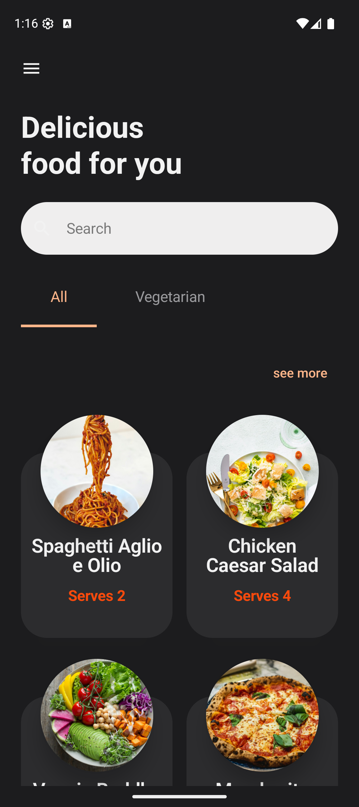
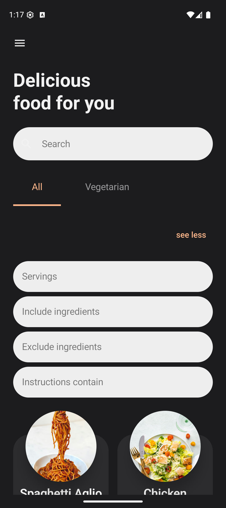
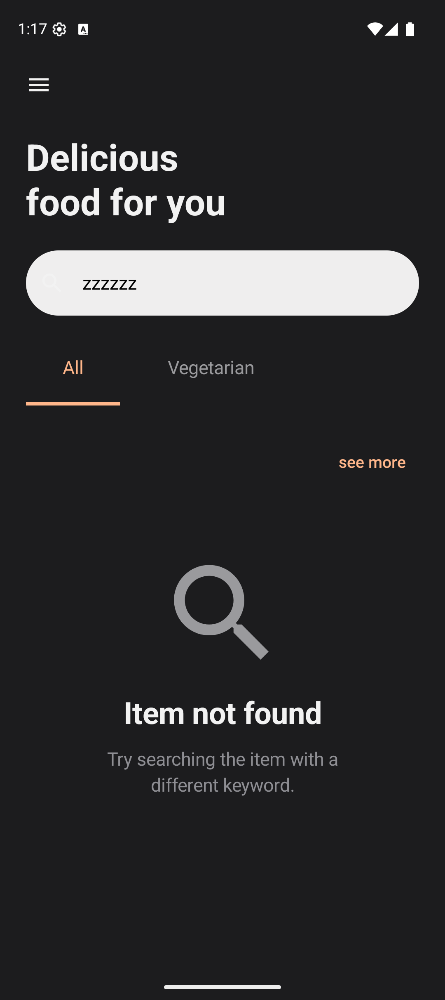
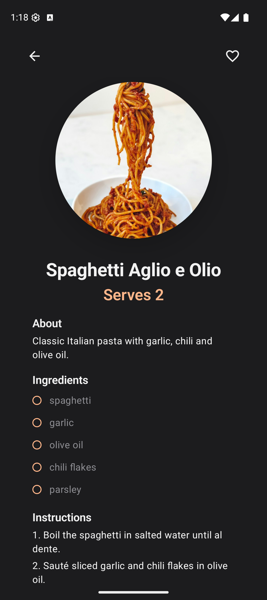
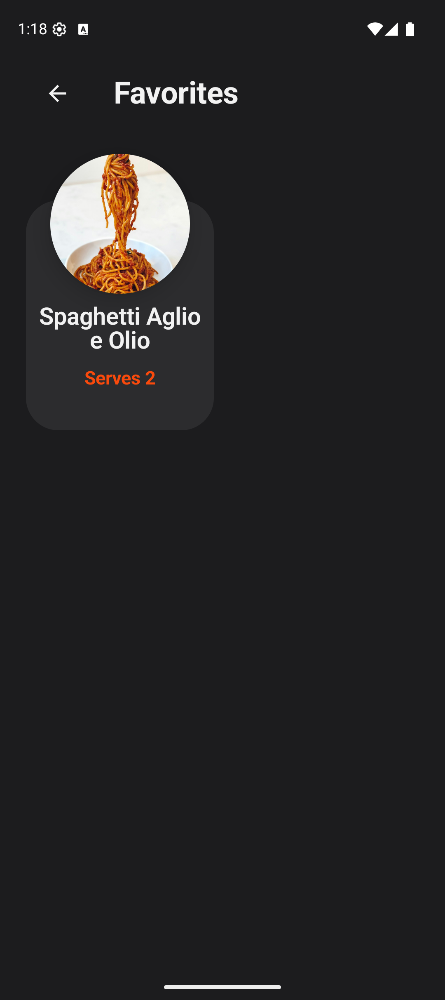

# 🍽️ ReciMe Challenge Android App

Native Android application built with **Jetpack Compose** to browse, search, and save recipes. Each recipe has a title, description, servings, ingredients, preparation steps, dietary attributes, and an optional image.

The API is mocked on purpose. This repository is a portfolio piece, and the goal is to show modern native Android development: Jetpack Compose, paging, clean architecture, local persistence, and a network boundary that already behaves like a real backend. Standing up a live service is outside that goal. The debug build talks to a **mocked HTTP API** (a local JSON catalog served by an OkHttp interceptor) so the app is structured as if the data came from a real backend. Release builds point at a configurable base URL and never ship the mock.

This project shows **declarative UI**, **paged lists**, **clean architecture**, and a small reusable design system.

---

## 📱 Usage & Important Note

> **⚠️ ATTENTION:** Debug and release do not share a backend.

- **Debug** calls `https://mock.recime.invalid/`. An OkHttp interceptor answers `GET /recipes/search` and `GET /recipes/{id}` from `app/src/debug/assets/recipes.json`, expanded to a **100-recipe catalog**, with a short simulated latency. Recipe images come from debug assets.
- **Release** reads `RECIME_API_BASE_URL` (Gradle property or environment variable). Without it, the release client has an empty base URL and cannot load recipes. The mock interceptor is compiled only into the `debug` source set.
- Search text is debounced (**300 ms**). Category changes (All / Vegetarian) and clearing every filter apply immediately.
- Favorites are stored on the device with Room. A recipe opened successfully is snapshotted locally so the detail screen can still open after a later transient failure.

Open the navigation drawer for **All recipes** and **Favorites**. Tap a card to open the detail screen, and tap the heart to save or remove a favorite.

---

## 🌟 Features

- 🔎 **Search**: free-text query against the catalog, sent as `q` on `GET /recipes/search`.
- 🥬 **Filters**: vegetarian-only, exact servings, ingredients to include, ingredients to exclude, and a match inside the preparation steps.
- 📄 **Cursor pagination**: opaque `cursor` + `limit` (page size 20). The home grid loads the next page as the user scrolls.
- 🗂️ **Recipe grid**: two-column `LazyVerticalGrid` with stable item keys, loading, empty, and error rows, and retry on a failed page.
- 📖 **Recipe detail**: about, ingredients, numbered instructions, and a favorite toggle.
- ❤️ **Favorites**: a dedicated screen backed by Room. Empty state explains how to save a recipe.
- 🧭 **Navigation**: type-safe Navigation Compose destinations for home, favorites, and detail, opened from a Material 3 drawer.
- 🖼️ **Images**: Coil loads recipe images with a shared placeholder treatment from the design system.
- 💀 **Loading, empty, and error states**: refresh and append errors on the home list, and `Loading` / `Success` / `Error` on detail and favorites, each with retry.
- 📴 **Detail fallback**: a previously loaded recipe can still open from the local snapshot when the network fails transiently (timeout, HTTP 429, or 5xx) or the device is offline.

---

## 🧱 Architecture

The app follows **MVVM** and **unidirectional data flow** on top of **Clean Architecture**. UI depends on domain. Data depends on domain. Domain does not depend on Android UI or on the data layer.

```
ui/
├── home/        -> HomeRoute, HomeScreen, HomeViewModel, HomePagingSource, filters
├── detail/      -> RecipeDetailRoute, RecipeDetailScreen, RecipeDetailViewModel
├── favorites/   -> FavoritesRoute, FavoritesScreen, FavoritesViewModel
└── navigation/  -> HomeNavHost and type-safe destinations
domain/
├── model/       -> Recipe, RecipeQuery, RecipePage, pagination, errors
└── repository/  -> RecipeRepository, FavoritesRepository
data/
├── remote/      -> RecipeApi (Retrofit), DTOs, OkHttp/Json, Hilt network graph
├── local/       -> Room (recipe snapshots + favorites)
├── repository/  -> DefaultRecipeRepository, RoomFavoritesRepository
└── mapper/      -> DTO and entity to domain
designsystem/
├── theme/       -> ReciMeTheme, color, type, shape
└── component/   -> cards, search bar, tabs, images, empty state, top bar
```

Debug-only code (`MockApiInterceptor`, the JSON catalog, and bundled images) lives in `app/src/debug` and is contributed through an OkHttp `Set<Interceptor>` multibinding. Production code depends on the Retrofit `RecipeApi` contract, never on a fake implementation of that interface.

Why two Gradle modules: `:designsystem` has no domain types, so the compiler keeps shared UI reusable. Domain, data, and UI stay as packages inside `:app` because there is a single feature.

---

## 📁 Directory Structure

```
ReciMeChallenge/
├── app/
│   └── src/
│       ├── main/kotlin/com/recime/challenge/
│       │   ├── data/
│       │   │   ├── local/          -> ReciMeDatabase, DAOs, snapshot store
│       │   │   ├── remote/         -> RecipeApi, DTOs, network DI
│       │   │   ├── repository/     -> DefaultRecipeRepository, RoomFavoritesRepository
│       │   │   └── mapper/
│       │   ├── domain/
│       │   │   ├── model/          -> Recipe, RecipeQuery, RecipePage
│       │   │   └── repository/
│       │   ├── ui/
│       │   │   ├── home/
│       │   │   ├── detail/
│       │   │   ├── favorites/
│       │   │   └── navigation/
│       │   ├── MainActivity.kt
│       │   └── ReciMeApplication.kt
│       ├── debug/                  -> MockApiInterceptor, recipes.json, images
│       ├── test/                   -> unit tests and fakes
│       └── androidTest/            -> instrumented UI tests
├── designsystem/
│   └── src/main/kotlin/.../designsystem/
│       ├── component/              -> ReciMeRecipeCard, ReciMeSearchBar, ...
│       └── theme/
├── gradle/libs.versions.toml
└── .github/workflows/ci.yml
```

---

## 📄 Main Classes Summary

- **HomeScreen / HomeRoute**: stateless grid screen. `HomeRoute` collects filters and `LazyPagingItems` from `HomeViewModel`.
- **HomeViewModel**: holds `SearchFilters`, debounces them into a `RecipeQuery`, and exposes a `PagingData` flow cached in `viewModelScope`.
- **HomePagingSource**: loads one `RecipePage` per cursor and maps `nextCursor` to the next Paging key.
- **RecipeDetailViewModel**: loads one recipe, toggles the favorite, and maps failures to a string resource, including `RecipeNotFoundException`.
- **FavoritesViewModel**: observes the Room favorites list and exposes `Loading`, `Success`, and `Error`.
- **DefaultRecipeRepository**: calls `RecipeApi`, maps DTOs to `Recipe`, writes snapshots, and falls back to Room on transient detail failures.
- **RecipeApi**: Retrofit contract for search (query, filters, cursor, limit) and get-by-id.
- **MockApiInterceptor**: debug HTTP stand-in. Filters the in-memory catalog and returns cursor pages, including 400 for an invalid cursor or limit.
- **ReciMeRecipeCard** and **ReciMeRecipeImage**: design-system pieces. They receive primitives, not `Recipe`.

---

## 🧪 Technologies Used

| Category | Technology / Library | Documentation / Link |
|---|---|---|
| Language | Kotlin 2.4 | [Docs](https://kotlinlang.org/) |
| UI | Jetpack Compose, Material 3 | [Docs](https://developer.android.com/jetpack/compose) |
| Lists | Paging 3 + `LazyVerticalGrid` | [Docs](https://developer.android.com/topic/libraries/architecture/paging/v3-overview) |
| Navigation | Navigation Compose (type-safe routes) | [Docs](https://developer.android.com/develop/ui/compose/navigation) |
| DI | Hilt | [Docs](https://dagger.dev/hilt/) |
| Async | Coroutines, `StateFlow` | [Docs](https://kotlinlang.org/docs/coroutines-overview.html) |
| Network | Retrofit, OkHttp, kotlinx.serialization | [Docs](https://square.github.io/retrofit/) |
| Persistence | Room | [Docs](https://developer.android.com/training/data-storage/room) |
| Images | Coil 3 | [Docs](https://coil-kt.github.io/coil/) |
| Quality | Detekt, Kover, JUnit, Robolectric | [CI](.github/workflows/ci.yml) |
| Build | Gradle Kotlin DSL, AGP 9.4, JDK 17 | [Version catalog](gradle/libs.versions.toml) |

SDK: `minSdk` 26, `targetSdk` 36, `compileSdk` 37.

---

## 🎯 Implementation Highlights

- **API-shaped data layer**: screens never read the JSON file. Search and detail go through Retrofit, and the mock sits on the HTTP boundary in `src/debug` only.
- **Opaque cursors**: `RecipeRepository.searchRecipes(query, cursor, limit)` returns `RecipePage(recipes, nextCursor)`. The UI does not invent page indexes.
- **Filter contract**: vegetarian, servings, include/exclude ingredients, and instruction text are query parameters, matching the challenge search requirements.
- **Paged home list**: `PagingConfig` uses a page size of 20, the same size for the initial load, placeholders off, and a prefetch distance of half a page. Items use a stable key and a content type.
- **Errors stay on screen**: repositories throw. ViewModels catch, rethrow `CancellationException`, and expose a `@StringRes` message plus retry. Expected HTTP 404 becomes `RecipeNotFoundException`.
- **Boundaries**: DTOs stay in `data/remote/model`. `:designsystem` does not depend on `:app`. User-visible copy lives in `strings.xml`.
- **Quality bar**: `./gradlew assembleDebug testDebugUnitTest detekt` is the local check. CI also runs Kover on the selected ViewModels and builds a minified release bundle.

---

## 🔧 Installation and Execution

Prerequisites:

- Android Studio with a current Android SDK
- JDK 17 (`JAVA_HOME`; Android Studio's bundled JBR is enough)
- An emulator or a device on API 26+

```bash
git clone <repository-url>
cd ReciMeChallenge

# Debug app with the bundled mock API
./gradlew :app:installDebug
```

Release needs a real base URL and, to install a signed build, a keystore:

```bash
export RECIME_API_BASE_URL="https://api.example.com/"
export RELEASE_KEYSTORE_PATH="/absolute/path/release.jks"
export RELEASE_KEYSTORE_PASSWORD="***"
export RELEASE_KEY_ALIAS="***"
export RELEASE_KEY_PASSWORD="***"

./gradlew :app:assembleRelease
```

Useful checks:

```bash
./gradlew assembleDebug testDebugUnitTest detekt
./gradlew :app:connectedDebugAndroidTest
```

---

## 📸 Screenshots

Captured on a Pixel emulator from the debug build.

| Home | Filters | Empty search |
|:---:|:---:|:---:|
|  |  |  |

| Recipe detail | Favorites |
|:---:|:---:|
|  |  |

---

## 🚀 Possible Next Steps

The challenge app already pages with cursors, keeps only a window of rows on screen, and never ships the mock in release. The notes below are what I would do before running the same product with **very large lists** and **millions of users**, and how I would add the next product areas without collapsing them into `:app`. They assume the search API stays the source of truth and the device only holds a window of results plus the user's own saved data.

### Huge lists on device

- **Keep cursor pagination and push every filter to the server.** The debug catalog filters 100 recipes in memory. A production catalog cannot. The existing `cursor` / `limit` contract is the right shape; offset pages get slower as the user scrolls deeper, and they shift when the catalog changes.
- **Split the list payload from the detail payload.** Home should receive id, title, image, servings, and the dietary flags. Ingredients and instructions belong on `GET /recipes/{id}`. That cuts bytes per page and the work Compose does for off-screen items.
- **Make Room the list source of truth with Paging `RemoteMediator`.** Today the grid collects `PagingData` straight from the network, and Room stores snapshots for detail fallback and favorites. For a catalog people revisit offline, the mediator writes each page into Room and the UI pages the database. Scroll position, process death, and a flaky network then read local rows.
- **Bound image work.** Request images at the card size, keep Coil's memory and disk caches, and prefetch only the next page. A million-recipe catalog is mostly an image problem on a phone: decode size and cache eviction matter more than the row count, because Paging already composes the visible window.
- **Measure scroll, then optimize.** Add a Macrobenchmark for fling on the home grid and generate a Baseline Profile for startup and first scroll. R8 is already on for release. Stable `key` and `contentType` are already set; the next win is fewer recompositions when only the favorite heart changes (pass that flag as a lambda or a small state read).
- **Cap the local database.** Snapshot and list tables need a retention policy (last N pages, or rows newer than a TTL). Unbounded Room growth will fill storage for someone who searches all day.

### Search that survives a large catalog

- **Serve search from an index**, not from a table scan. Free text, instruction text, and include/exclude ingredients want tokenized fields (for example OpenSearch), with vegetarian and servings as filters on the same query.
- **Cache hot queries at the edge.** The first page of "All" and "Vegetarian" will dominate traffic. A short TTL on the first cursor page, plus `ETag` / `Cache-Control` that OkHttp can honor, removes most repeat reads.
- **Keep the client cheap while the user types.** Debounce and `distinctUntilChanged` are already in place. Add cancellation of the previous search (Paging already drops the previous `Pager` on a new query via `flatMapLatest`) and ignore stale responses if a later query won.
- **Return a cheap "no more results" cursor** and reject abusive `limit` values, as the mock already does (`limit` must be between 1 and 100). Clients should not be able to ask for thousands of rows in one call.

### Millions of users

- **Put images on a CDN** with stable URLs, resized variants, and cache headers. The API should not stream image bytes.
- **Scale reads separately from writes.** Recipe search is read-heavy. Replicas (or the search index) absorb browse traffic. Favorite writes are per user and small; they can live on a primary with a queue if a burst of heart-taps arrives.
- **Sync favorites per account.** Room is the right local cache, but a production favorite is `(userId, recipeId)` on the server, with a last-write timestamp so two devices converge. The UI can stay optimistic: toggle locally, reconcile when the call returns.
- **Protect the API.** Per-user and per-IP rate limits, backoff on HTTP 429 (the detail path already treats 429 as transient), and pagination limits stop one client from paging the entire catalog in a tight loop.
- **Watch the paging funnel.** Track time-to-first-page, append failure rate, image error rate, and ANRs on the home grid. Those four numbers tell you whether the list is actually holding up.
- **Roll out in stages.** Feature-flag the RemoteMediator path and the thinner list DTO. Ship to a small percentage, compare scroll jank and error rate, then expand.
- **Sign in before any user-owned cloud data.** The challenge stores favorites on one device. Accounts, token refresh, and wiping Room on logout are the gate for a synced favorite list. How that feature sits next to the others is below.

### How I would organize the next features

Browse, detail, and favorites are one product area today, so they stay as packages inside `:app`. A new filter, a sort option, or a richer block on the detail screen lands in `ui/home` or `ui/detail`. `:designsystem` remains the only shared UI module, and it still receives primitives, never a `Recipe`.

A second product area (account, meal plan, grocery list) is the point where I would split by feature, top to bottom. Shared infrastructure moves out of `:app` only for what those features actually share. `:app` stays the composition root: `Application`, Hilt aggregation, the drawer, and the `NavHost`.

```
:app
├── ReciMeApplication, MainActivity
└── navigation/             -> composes feature graphs and the drawer
:core:common                -> dispatchers, error mapping, pagination types
:core:network               -> OkHttp, Retrofit, auth header
:core:database              -> ReciMeDatabase and migrations
:core:designsystem          -> today's :designsystem
:feature:recipes            -> search, home grid, detail
:feature:favorites          -> saved recipes, once they belong to an account
:feature:account            -> sign-in, session, logout
:feature:mealplan
:feature:grocery
```

Rules for that split:

- Each feature module owns its `ui`, `domain`, and `data`. Another screen opens it through a typed destination (`recipeId`, `planDate`) registered in `:app`.
- A feature that needs recipe data depends on a small `:feature:recipes-api` (the `Recipe` read model and `RecipeRepository`), never on recipe screens or `HomeViewModel`.
- A component moves into `:core:designsystem` when a second feature uses it. A card that only the home grid renders stays inside `:feature:recipes`.
- `Recipe` stays in the recipes feature until two features own that concept. Favorites, meal plan, and grocery store a `recipeId` and read a title or an ingredient list through the recipes API.
- Each feature keeps unit tests next to its packages and ships behind its own flag, so it can roll out without a release of the others.
- Public surface of a feature stays small: one route entry, one repository interface when another feature must read it, and string resources inside that module.

Order I would build them:

1. **Account.** Session, token refresh, and a logout that clears user rows in Room. Later features key their local and remote data by `userId`.
2. **Favorites sync.** The screen already exists. It becomes account-scoped, still resolves titles through the recipes read model, and moves to `:feature:favorites` when the API is real.
3. **Collections.** Named groups of recipes, paged with the same cursor contract as home. They live beside favorites until their write model is large enough for a module of their own.
4. **Meal plan.** A calendar of `recipeId` plus a date. It writes plan entries and reads recipes through `:feature:recipes-api`.
5. **Grocery list.** Aggregates ingredients from the current meal plan, with its own checked state. Ingredient text stays owned by recipes, so a change in how a recipe is stored stays inside that feature.

`HomeViewModel` keeps owning search, filters, and the paged grid. New product areas get their own ViewModel, route, and module instead of growing the home screen.

None of this replaces the current debug mock. The mock should stay a small, deterministic HTTP stand-in for tests and for local UI work.

---

## 🧑‍💻 Author

Developed by Tiago as part of the ReciMe Android coding challenge.

Focused on **clean architecture**, **a paged recipe browser**, and **a UI that explains loading, empty, and error states**.

---

## 📝 License

```
The MIT License (MIT)

Copyright (c) 2026 ReciMe Challenge

Permission is hereby granted, free of charge, to any person obtaining a copy
of this software and associated documentation files (the "Software"), to deal
in the Software without restriction, including without limitation the rights
to use, copy, modify, merge, publish, distribute, sublicense, and/or sell
copies of the Software, and to permit persons to whom the Software is
furnished to do so, subject to the following conditions:

The above copyright notice and this permission notice shall be included in all
copies or substantial portions of the Software.

THE SOFTWARE IS PROVIDED "AS IS", WITHOUT WARRANTY OF ANY KIND, EXPRESS OR
IMPLIED, INCLUDING BUT NOT LIMITED TO THE WARRANTIES OF MERCHANTABILITY,
FITNESS FOR A PARTICULAR PURPOSE AND NONINFRINGEMENT. IN NO EVENT SHALL THE
AUTHORS OR COPYRIGHT HOLDERS BE LIABLE FOR ANY CLAIM, DAMAGES OR OTHER
LIABILITY, WHETHER IN AN ACTION OF CONTRACT, TORT OR OTHERWISE, ARISING FROM,
OUT OF OR IN CONNECTION WITH THE SOFTWARE OR THE USE OR OTHER DEALINGS IN THE
SOFTWARE.
```
