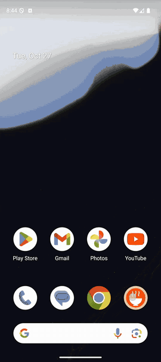

# ReciMe Challenge

Native Android recipe browser built with Kotlin and Jetpack Compose. It
browses, searches, opens and favorites recipes with explicit loading, empty,
error and retry states.

## Demo

<p style="text-align: center;">
  
</p>

Walkthrough: the Vegetarian tab (only vegetarian recipes are listed; switching
back to All restores the full catalog), advanced filters, the Favorites screen
(including its empty state), recipe details, adding and removing favorites,
and search with an empty state.

## Features

- Cursor-paginated catalog and combinable recipe filters.
- Recipe details and favorites persisted with Room/DataStore.
- Offline recovery for opened recipes and favorites.
- Type-safe Navigation Compose, previews and accessible Compose UI.

## Tech stack

Kotlin 2.4, AGP 9.4, JDK 17, AndroidX, Compose Material 3, Hilt, Coroutines,
Paging 3, Retrofit, OkHttp, kotlinx.serialization, Room, Coil, JUnit 4,
Robolectric, Compose UI tests, Detekt and Kover.

## Architecture

The project has three Gradle modules:

```text
:app         domain, data, home/detail/favorites UI and navigation
:designsystem reusable theme and recipe components
:benchmark   macrobenchmarks and Baseline Profile generator
```

The flow is `Compose UI -> ViewModel -> PagingSource -> domain repository ->
data`. Domain contracts contain plain models only. Room stores opened recipe
records and favorites; it is not a catalog page cache or `RemoteMediator`.
The debug backend is an OkHttp interceptor reading
`app/src/debug/assets/recipes.json`, never a fake `RecipeApi`.

## Scalability and performance

The client uses opaque cursor/keyset pagination, server-sized requests,
debounced search with `flatMapLatest`, stable grid keys/content types, and
forward-only paging. Removing `maxSize` avoids unrecoverable dropped pages:
memory grows with how far a user scrolls, while Coil bounds image memory with
its own caches. Room remains a local store for opened recipes and favorites,
not the home-list cache. OkHttp uses a GET-only retry interceptor with exponential backoff and jitter.
The debug/benchmark mock short-circuits the application chain. Disk-backed
HTTP caching is intentionally disabled so emulator filesystem initialization
cannot block the main thread during startup. ProfileInstaller is included
so Baseline Profiles can be installed outside Google Play.

Run `./gradlew :benchmark:connectedBenchmarkAndroidTest` on a physical device
after installing the benchmark APK to measure cold start and frame duration
with and without the Baseline Profile (build type `benchmark`).

See [docs/scalability.md](docs/scalability.md) for implementation details and
reproduction commands.

## Setup and commands

Use JDK 17 and Android SDK 37.

```bash
./gradlew assembleDebug
./gradlew testDebugUnitTest
./gradlew detekt
./gradlew connectedDebugAndroidTest
./gradlew :app:bundleRelease
./gradlew :benchmark:assemble
./gradlew :benchmark:connectedBenchmarkAndroidTest
./gradlew -PcomposeReports :app:compileDebugKotlin :designsystem:compileDebugKotlin
```

The debug build uses the local mock. Release requires a production base URL
configuration and excludes the mock source/assets. Build outputs and reports
are not committed.
